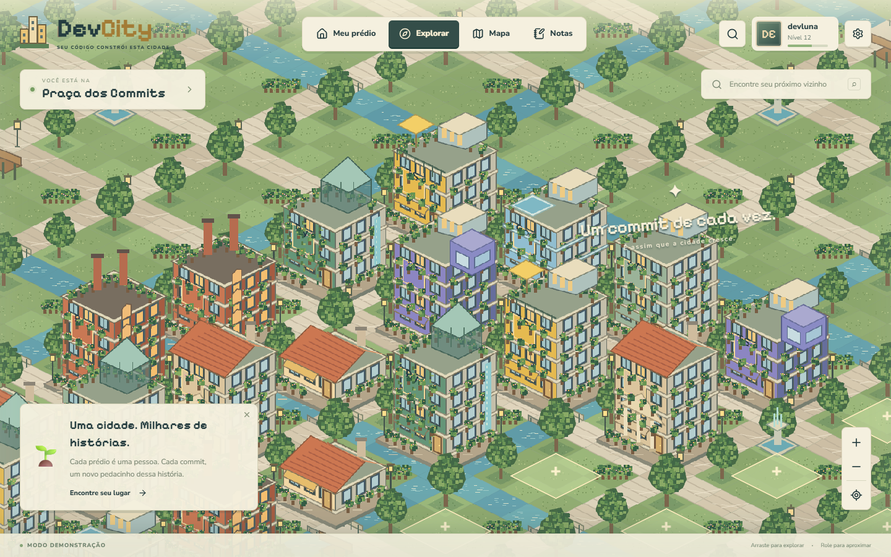

# DevCity

**Seu código constrói esta cidade.** Uma aplicação em português com cidade isométrica compartilhada, prédios que evoluem por commits do GitHub e um caderno privado de notas.



## Executar agora

Requer Node.js 24 e npm. Na pasta do projeto:

```sh
npm ci
npm run dev
```

Abra **http://127.0.0.1:5173**. Sem variáveis de ambiente a aplicação usa **modo demonstração**, com moradores e projetos fictícios. Clique em **Conhecer a demonstração completa** para experimentar como devluna. Notas e recados de demonstração são salvos somente no navegador. Não existe consulta GitHub nem XP real nesse modo. Em Configurações é possível redefinir esses dados.

O projeto não usa as imagens de referência como fundo. O mapa é composto de tiles e sprites reutilizáveis desenhados em código, renderizados em PixiJS com filtragem nearest-neighbor. A arte atual é simplificada e pode ser substituída por sprites definitivos.

## O que está implementado

- Tela de boas-vindas e exploração de visitantes.
- Câmera com arraste, zoom, pinça no touch e centralização. Navegação por bairros, busca e links públicos de prédios.
- Mundo determinístico em chunks de 12 × 12 tiles, incluindo coordenadas negativas, ruas, canais, pontes, vegetação, bancos, postes e fontes.
- Carga de dados por região, descarregamento de chunks distantes, culling de prédios e adereços, texturas compartilhadas e renderização sob demanda.
- Cinco estágios visuais: níveis 1–4, 5–9, 10–19, 20–34 e 35+. Casa inicial igual para todos; estilos JavaScript, Python, Rust, Go, TypeScript, Java e genérico.
- OAuth GitHub via Supabase Auth, perfil identificado pelo ID estável do GitHub e atualização de nomes sem mover terrenos.
- Aquisição de terreno em transação, propriedade única, expansão automática quando a ocupação chega a 80%.
- Integração GitHub GraphQL no backend, snapshots por dia UTC, teto diário, processamento idempotente, leases e recuperação de trabalhos.
- Animação de evolução com andaimes, partículas e troca de sprite; respeito a movimento reduzido e confirmação do evento no banco após a animação.
- Perfil público, repositórios em destaque, mural de recados predefinidos, limites diários, bloqueio de remetentes, exclusão de recados e desativação do mural.
- Notas com categorias, pesquisa, links, Markdown, checklists, salvamento automático e controle de conflitos por versão. HTML é ignorado e links só permitem HTTP(S).
- Exclusão da conta com remoção dos dados privados e liberação do terreno.
- Interface responsiva, menu inferior no celular e modo de vegetação reduzida.

Não há construtor, edição de arquitetura, interiores, personagem controlável, chat livre ou ranking competitivo.

## Ativar contas e cidade reais

As integrações precisam de um projeto Supabase e configuração do proprietário. Nenhuma credencial real acompanha o código.

1. Crie um projeto Supabase. Instale a CLI oficial (`npx supabase --help`), autentique e vincule o projeto:

   ```sh
   npx supabase login
   npx supabase link --project-ref SEU_PROJECT_REF
   npx supabase db push
   ```

2. Crie um OAuth App no GitHub. Use como callback:

   ```text
   https://SEU_PROJECT_REF.supabase.co/auth/v1/callback
   ```

   Habilite o provedor GitHub no painel Authentication do Supabase e informe Client ID e Client Secret. Não habilite permissões de repositórios privados. O frontend pede apenas `read:user` para identidade e perfil, sem `repo`.

3. Configure o Site URL e a lista de redirects do Supabase para sua origem de produção e `http://127.0.0.1:5173/cidade` no desenvolvimento.

4. Copie `.env.example` para `.env.local` e preencha somente:

   ```dotenv
   VITE_SUPABASE_URL=https://SEU_PROJECT_REF.supabase.co
   VITE_SUPABASE_ANON_KEY=SUA_CHAVE_PUBLICA
   ```

   Nunca use uma chave `service_role` em variáveis `VITE_`. Reinicie o Vite após alterar variáveis.

5. Configure secrets no backend, preferencialmente pelo painel Supabase para não gravar tokens no histórico do terminal:

   | Secret         | Uso                                                                                                    |
   | -------------- | ------------------------------------------------------------------------------------------------------ |
   | `GITHUB_TOKEN` | Token de servidor para GraphQL, limitado a dados públicos; não solicite acesso a repositórios privados |
   | `SYNC_SECRET`  | Segredo longo e aleatório usado somente pelo agendador                                                 |
   | `APP_ORIGIN`   | Origem exata do frontend, por exemplo `https://meu-projeto.pages.dev`                                  |

   `SUPABASE_URL` e `SUPABASE_SERVICE_ROLE_KEY` são fornecidos pelo ambiente das Edge Functions. O token GitHub não é enviado nem persistido pelo frontend. As sessões de acesso Supabase são gerenciadas pelo SDK de autenticação.

6. Publique as funções:

   ```sh
   npx supabase functions deploy bootstrap
   npx supabase functions deploy sync-github
   npx supabase functions deploy delete-account
   ```

   `verify_jwt = false` no arquivo de configuração permite o header secreto do cron e chaves modernas. **As funções continuam autenticadas:** cada operação do usuário valida o bearer token com `auth.getUser`; o cron compara `x-sync-secret` no backend.

7. No Supabase Vault, crie os segredos `devcity_function_url` (URL completa da função `sync-github`) e `devcity_sync_secret` (mesmo valor de `SYNC_SECRET`). Execute `supabase/schedule.sql` no SQL Editor. O cron executa no minuto 17 de cada hora e processa usuários que estão devidos; cada perfil completo é sincronizado a cada 24 horas. O arquivo é reexecutável sem duplicar o agendamento.

8. Teste com **duas contas GitHub distintas**, em navegadores ou perfis diferentes: escolha dois terrenos, visite os prédios, envie presets, crie notas e confirme que as notas são privadas. Esses testes contra serviços reais exigem configuração e ainda não foram executados neste ambiente.

## Regras de progresso

`xpParaNivel(n) = 25 × (n − 1) × n`. Cada commit elegível rende 10 XP, com no máximo 100 XP por dia UTC. Esses parâmetros e o limite de expansão estão centralizados nas funções SQL da migração inicial; alterações precisam manter as descrições do frontend consistentes.

O dia UTC do cadastro é excluído. Os agregados diários do GitHub não permitem distinguir com segurança os commits anteriores e posteriores à hora do cadastro. O primeiro dia recompensável é o dia UTC seguinte. Dias incompletos não são processados.

Somente `CreatedCommitContribution.commitCount` de repositórios **públicos**, nos dias da `contributionsCollection`, gera XP. Não usamos a soma geral do calendário, issues, PRs, estrelas ou contagens privadas. O gráfico do GitHub define a elegibilidade, portanto o número pode diferir dos commits brutos feitos em qualquer branch. O identificador numérico é resolvido por `/user/{account_id}` antes das consultas GraphQL, preservando a identidade após renomeações.

A linguagem predominante é uma aproximação pela soma de **bytes de código** dos repositórios públicos próprios e não-forks, com paginação. Não é a linguagem de cada commit. Linguagens sem um estilo específico usam arquitetura genérica.

Cada sincronização revisita sete dias anteriores para absorver dados atrasados e processa até 21 dias novos. Snapshots mantêm o maior total validado; reescritas posteriores não retiram XP nem concedem XP duplicado. Casos de truncamento de contribuições (100 repositórios no mesmo dia) ou mais de 100 linguagens por repositório falham de forma explícita, preservando o estado anterior, em vez de premiar dados incompletos. Para reprocessar datas mais antigas, um administrador pode recuar `github_sync_jobs.next_date` e `retry_after` pelo SQL Editor; a idempotência permanece válida.

O worker usa leases de cinco minutos, concorrência de um usuário por vez, lotes de até cinco usuários e retry com backoff para falhas 5xx. Leases expirados podem ser retomados. Erros e rate limits preservam o progresso. Antes de aumentar a comunidade, ajuste o tamanho dos lotes e a frequência do cron aos limites de tempo e requisições do plano contratado; não foi realizado teste de carga para milhares de contas.

## Segurança e dados

RLS está habilitado em todas as tabelas públicas. Visitantes leem apenas dados públicos. Notas e eventos de evolução são limitados por `auth.uid()`. Atualizações de notas passam por `save_note`, que confere proprietário e versão. Permissões diretas de escrita em XP, perfis, terrenos e sincronização são revogadas dos papéis web. `claim_lot` usa bloqueio transacional e índices únicos. RPCs administrativas são restritas a `service_role`.

O mural armazena IDs de cinco mensagens, com máximo de dez por remetente/dia e três por prédio/dia, sem repetição do mesmo preset. A verificação é feita sob lock do remetente. O dono pode excluir recados, bloquear novos envios ou desativar o mural. As exclusões de notas e de conta pedem confirmação na interface.

O modo demonstração usa armazenamento local e **não oferece isolamento de segurança entre pessoas que compartilham o mesmo navegador**. A privacidade entre contas reais é fornecida por Auth e RLS no Supabase.

## Verificação

```sh
npm run lint
npm test
npm run build
npx playwright install chromium
npm run test:e2e
npx --yes deno check supabase/functions/bootstrap/index.ts supabase/functions/sync-github/index.ts supabase/functions/delete-account/index.ts
```

Os testes de banco usam **PGlite, PostgreSQL embarcado**, com as migrações reais, papéis e políticas RLS; `auth.users`, `auth.identities` e `auth.uid()` são simulados para o teste. Verificam isolamento entre contas, conflitos de notas, permissões administrativas, propriedade única, mural, renomeação GitHub, leases, teto diário e evolução transacional. O teste de exclusividade usa tentativas concorrentes serializadas pelo PostgreSQL embarcado; não substitui testes de contenção em conexões remotas de produção.

Playwright testa os fluxos visíveis em desktop e celular. Capturas são geradas em `test-results/`. O workflow do GitHub executa lint, testes, build e Playwright a cada push e pull request. As Edge Functions também podem ser verificadas com Deno; essa checagem valida tipos, sem executar chamadas reais a GitHub/Supabase.

## Publicar no Cloudflare Pages

Conecte o repositório e configure:

- Framework: Vite / React.
- Comando: `npm run build`.
- Diretório publicado: `dist`.
- Node: `24`.
- Variáveis públicas: as duas variáveis `VITE_SUPABASE_*` acima.

`public/_redirects` permite abrir links de prédios diretamente. `public/_headers` fornece headers básicos de segurança. Após a primeira publicação, atualize a origem de CORS, Site URL e redirects de OAuth para o domínio real. Não há deploy automático configurado para uma conta Cloudflare neste ambiente.

## Estrutura

```text
src/domain.ts          Regras de progresso, coordenadas e geração
src/art.ts             Tiles, adereços e prédios reutilizáveis
src/City.tsx           PixiJS, câmera, chunks, seleção e evolução
src/api.ts             Supabase e armazenamento separado da demonstração
src/App.tsx            Navegação, autenticação e painéis
src/Notes.tsx          Caderno privado, autosave e conflitos
supabase/migrations/  Schema, permissões, RLS e transações
supabase/functions/   Identidade, GraphQL, sincronização e exclusão
supabase/schedule.sql Agendamento pg_cron + pg_net + Vault
tests/                Regras, banco e navegador
```

Para trocar as artes, mantenha o mapeamento `spriteKey(language, stage)` e o ponto de apoio dos sprites. Tiles usam passo isométrico de 96 × 48 pixels. Os prédios usam canvas de 320 × 390, com base inferior alinhada ao lote. As imagens fornecidas pelo proprietário são referências conceituais, não assets de execução, e permanecem nos arquivos originais.
